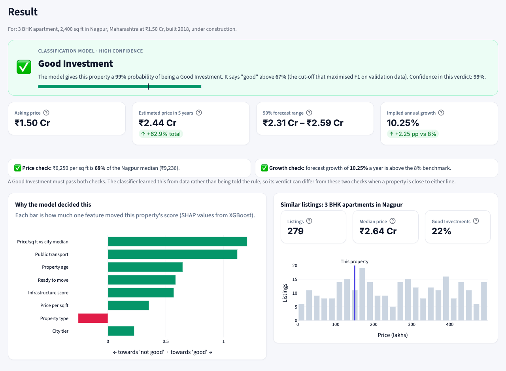
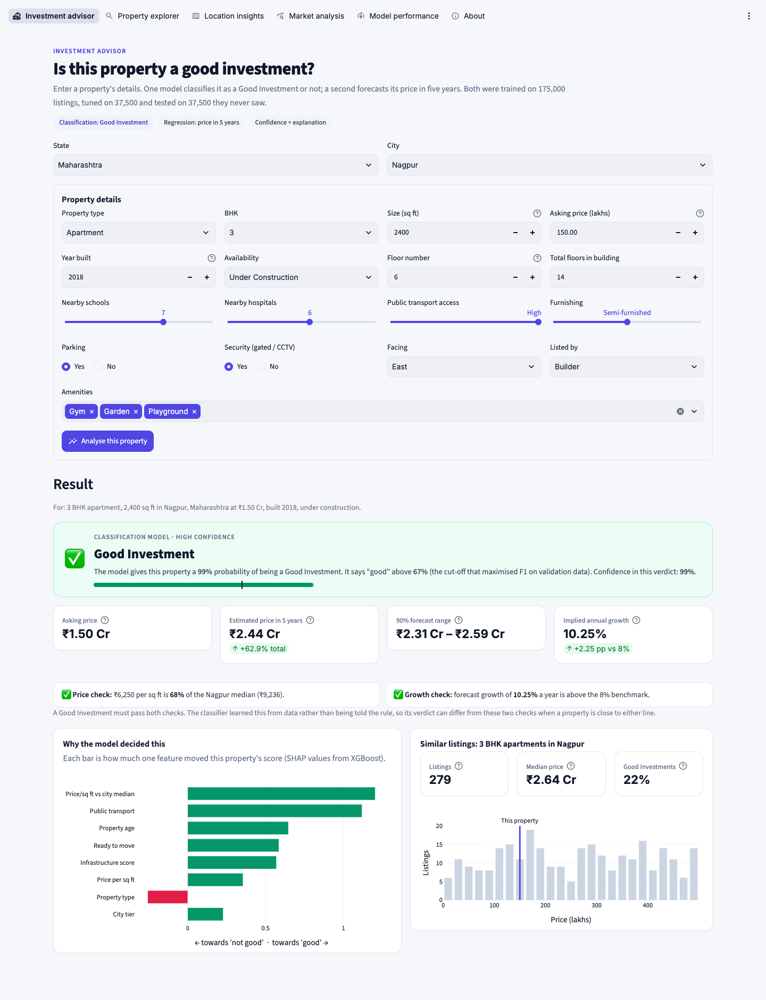
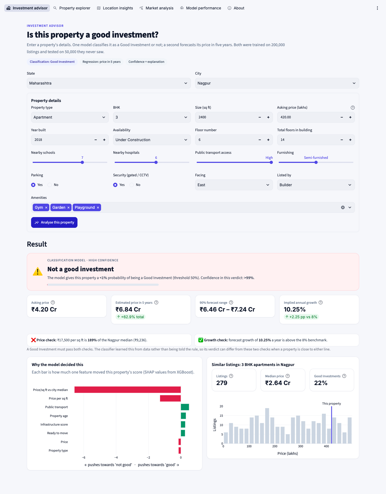
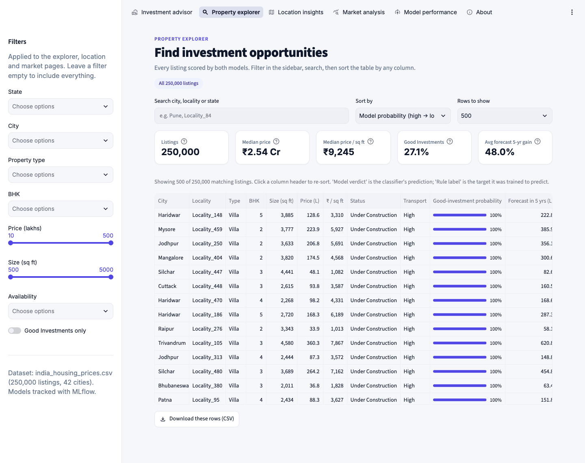
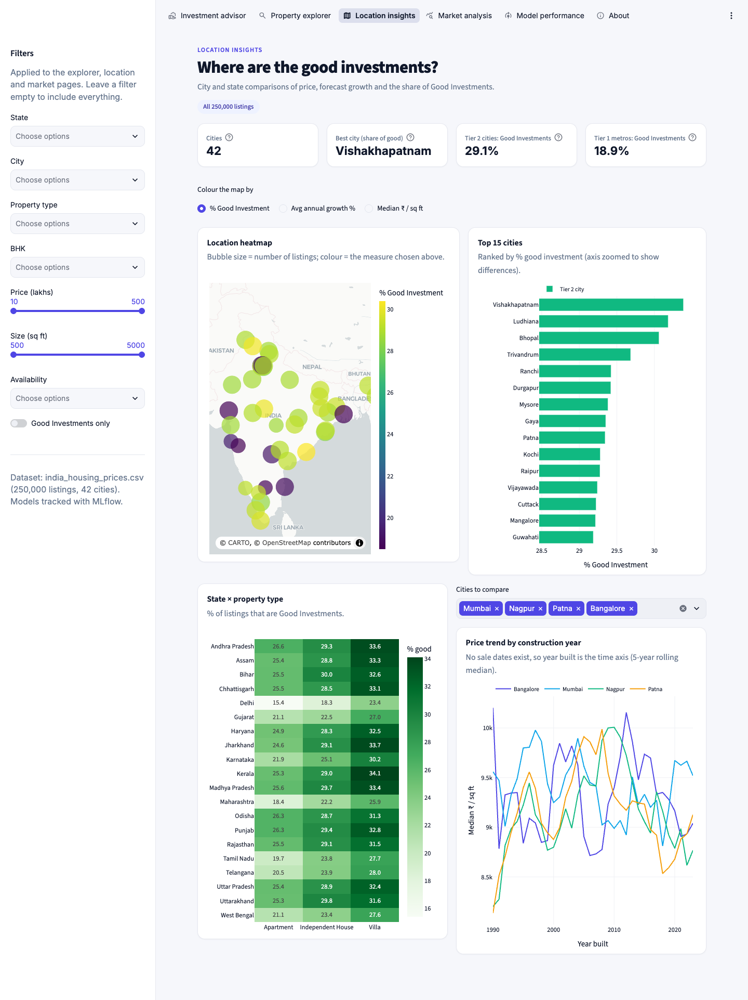
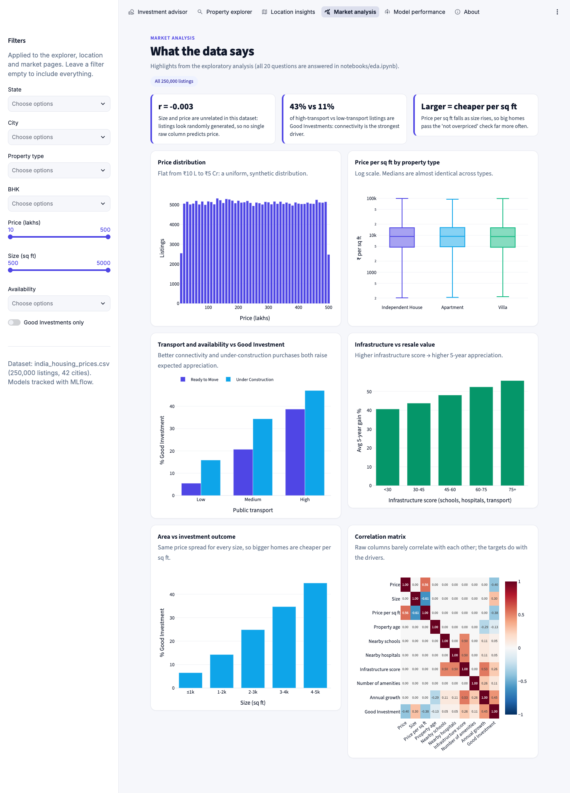
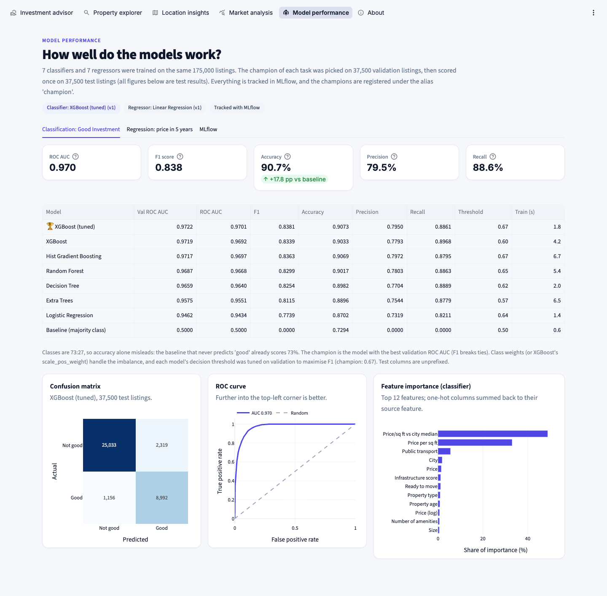

# Real Estate Investment Advisor

[](https://aryaman-real-estate-advisor.streamlit.app)


**Predicting property profitability and future value.** A machine-learning app that tells an investor whether a
property is a **Good Investment** (classification) and what it will be worth **in 5 years** (regression), built on
250,000 Indian property listings, tracked with **MLflow** and served through **Streamlit**.

| Task | Champion (chosen on validation) | Test-set result |
|---|---|---|
| Good Investment (classification) | Tuned XGBoost | ROC AUC **0.970**, F1 **0.838**, accuracy **90.7%**, precision 79.5%, recall 88.6% |
| Price in 5 years (regression) | Linear Regression on log price | RMSE **₹14.9 L**, MAE ₹10.4 L, R² **0.995**, MAPE 2.8%: **45% lower RMSE** than the fixed-8% formula |

- **Live app:** https://aryaman-real-estate-advisor.streamlit.app
- **App:** six pages: Investment advisor, Property explorer, Location insights, Market analysis, Model performance, About
- **Report:** [`reports/Real_Estate_Investment_Advisor_Report.pdf`](reports/Real_Estate_Investment_Advisor_Report.pdf)
- **EDA:** [`notebooks/eda.ipynb`](notebooks/eda.ipynb), answering all 20 EDA questions plus the statistical tests



---

## Business use cases
- **Investors** check a property's long-term return before buying: verdict, confidence, 5-year forecast with a 90% range.
- **Buyers** find high-return properties in developing areas: the explorer and the location pages rank every listing and city.
- **Real estate platforms** automate investment analysis: all 250,000 listings are scored by both models.
- **Trust**: every prediction shows its probability, the decision threshold, the two rule checks and a SHAP explanation.

## Run it locally
```bash
python -m venv .venv && source .venv/bin/activate      # Windows: .venv\Scripts\activate
pip install -r requirements.txt

python pipeline.py          # 1. clean + engineer features + build targets   -> data/processed/
python train.py             # 2. 14 models + 2 baselines, MLflow logging, registry, export -> models/  (~4 min)
python evaluate.py          # 3. reload the @champion models from the registry and re-check the test metrics
streamlit run app/streamlit_app.py                     # the app, on http://localhost:8501
python mlflow_ui.py                                    # MLflow UI on http://127.0.0.1:5000
```
The repo already contains the processed data, the trained models and the MLflow store, so the app and the MLflow UI
work straight after `pip install`. Every step is deterministic (fixed seeds), so re-running reproduces the same numbers.

## Project structure
| Path | Purpose |
|---|---|
| `config.py` | Every path, cleaning rule, target rule and model setting, in one place |
| `pipeline.py` | Raw CSV → cleaned, feature-engineered, labelled dataset (`data/processed/housing_clean.csv`) |
| `train.py` | Train/validation/test split, 14 models + baselines, threshold tuning, hyperparameter search, MLflow logging, registry |
| `evaluate.py` | Loads `models:/…@champion` from the MLflow registry and prints the full test evaluation |
| `mlflow_ui.py` | Opens the MLflow UI (and fixes MLflow's stored paths after a fresh clone) |
| `src/cleaning.py` | Type checks, missing values, duplicates, floor-number repair, price per sq ft in ₹, IQR outliers |
| `src/features.py` | Feature engineering, shared by training and the app |
| `src/targets.py` | Growth rate → `Future_Price_5Y` and `Good_Investment` |
| `src/eda.py` | One function per EDA question, the statistical tests and every chart |
| `src/modeling.py`, `src/tracking.py` | Model zoo, preprocessing pipelines, metrics; MLflow logging and registry helpers |
| `notebooks/eda.ipynb` | The EDA, executed, with written answers |
| `app/` | Streamlit app (`streamlit_app.py` entry, `views.py` pages, `data.py` data and models, `ui.py` styling) |
| `models/` | Champion models exported from the registry, metrics, evaluation details, city price references |
| `mlflow.db`, `mlruns/` | MLflow tracking store (experiments, runs, artifacts, model registry) |
| `reports/` | PDF report, EDA figures, app screenshots, and the scripts that build them |

## Methodology

### 1. Data cleaning (`src/cleaning.py`)
`india_housing_prices.csv`: 250,000 rows × 23 columns.

| Check | Finding | Action |
|---|---|---|
| Missing values | None | Median / mode imputation still runs, and sits inside the model pipeline for app input |
| Duplicates | None (also none ignoring `ID`) | — |
| `Floor_No` > `Total_Floors` | 116,304 rows (46.5%) | Values swapped back (a column mix-up), no rows lost |
| `Price_per_SqFt` | Stored in **lakhs**, rounded to 2 decimals | Recomputed exactly, in **₹** |
| Outliers (IQR) | Price 0, size 0, price per sq ft 19,723 | Genuine small, expensive homes: flagged (`Is_PPSF_Outlier`), kept |
| `Locality` | Each of 500 values appears in all 42 cities | Kept for display, excluded from models |
| `State`, `Year_Built` | Determined by `City` / `Age_of_Property` | Excluded from models as redundant |

### 2. Feature engineering (`src/features.py`)
`Price_per_SqFt` (₹), `Log_Price`, `PPSF_vs_City_Median`, `City_Tier` (the 8 X-class metros vs the rest),
`Infrastructure_Score` (0–100 from schools, hospitals and transport), `Amenity_Count`, `Amenity_Density_Score`
(amenities per 1,000 sq ft), five `Has_<amenity>` flags, `Transport_Score`, `Furnished_Level`, `Floor_Ratio`, and
parking / security / ready-to-move flags. Categories are one-hot encoded and numbers standardised inside a
scikit-learn pipeline, so the app applies exactly the same preprocessing.

### 3. Target definitions (assumptions)
The dataset has no sale history, so both targets follow documented domain rules (all in `config.py`), as the brief allows:

**Future_Price_5Y** = Price × (1 + r)^5, where r (% per year) = 5.5 base + adjustments + a random market shock (σ = 0.75 pp):

| Driver | Adjustment (pp per year) | Reason |
|---|---|---|
| Public transport | Low −1.0, Medium 0, High +1.0 | Connectivity drives resale demand |
| Under construction | +0.75 | Pre-launch pricing; value rises on completion |
| Villa / Independent house | +0.5 / +0.25 | Land appreciates; buildings age |
| Tier 2 city | +0.75 | Developing markets grow faster from a lower base |
| Security, parking | +0.25 each | Resale premium |
| Each amenity / each nearby school or hospital | +0.25 / +0.05 | Facilities and social infrastructure |
| Age | −0.04 per year of age above 15 (newer homes gain the same per year below) | Older buildings depreciate |

The base rate makes the market-wide average ≈ 8%, the rate in the brief's example; r is bounded to 2–15%.

**Good_Investment** = 1 when annual growth ≥ **8%** **and** price per sq ft ≤ the **city median**. This combines the
brief's three suggested rules (appreciation above a threshold, cheaper than the median, multi-factor). 27.1% of listings qualify.

### 4. Models (`train.py`)
- **Split:** stratified 70/15/15 (175,000 train / 37,500 validation / 37,500 test), shared by both tasks. Validation picks
  the champions, each classifier's decision threshold (maximising F1) and the forecast range; test is scored once.
- **Classification:** majority-class baseline, Logistic Regression, Decision Tree, Random Forest, Extra Trees, Hist
  Gradient Boosting, XGBoost and tuned XGBoost. Class imbalance (73:27) is handled with class weights or `scale_pos_weight`.
- **Regression:** fixed-8% baseline, Linear Regression, Ridge, Decision Tree, Random Forest, Hist Gradient Boosting,
  XGBoost and tuned XGBoost. Every model is trained on log(future price), which turns price × (1 + r)^5 into a sum.
- **Tuning:** XGBoost randomised search (12 candidates, 3-fold CV on a 40,000-row sample) for each task.
- **Metrics:** accuracy, precision, recall, F1, ROC AUC and confusion matrix; RMSE, MAE, MSE, R² and MAPE.

### 5. MLflow
- Experiments `good_investment_classification` and `future_price_regression`. Every run logs:
  - hyperparameters and all validation and test metrics
  - a confusion matrix or actual-vs-predicted plot
  - a feature-importance chart and JSON
  - the fitted pipeline with its input signature
- Registry: `RealEstate_GoodInvestment_Classifier` and `RealEstate_FuturePrice5Y_Regressor`, each with alias `@champion`.
- `python evaluate.py` proves the registry versions reproduce every reported metric and match the app's model files.

## Key findings
1. **The listings are synthetic.** Every raw column is uniform and independent: size vs price r ≈ 0.00, and average
   price differs by only 3% across 42 cities. No raw column predicts today's price.
2. **Connectivity drives investment potential.** Good Investments: 43% with high transport access vs 11% with low.
3. **Developing cities beat the metros.** Tier 2 cities: 29% Good Investments; the eight metros: 19%.
4. **Bigger homes are better value.** They are cheaper per sq ft: 45% of homes above 4,000 sq ft are Good
   Investments, vs 7% below 1,000.
5. **Infrastructure raises resale value.** The expected 5-year gain rises from 41% (score < 30) to 56% (score 75+).
6. **Some features don't matter.** Facing, owner type and furnishing have no relationship with price or the target
   (chi-square p > 0.7).

### Recommendations
Prioritise transport access and infrastructure over finishes; look beyond the metros; compare price per sq ft with the
city median, not the headline price; and use the model as a screen that shortlists listings for human due diligence.

### Limitations
The data is synthetic and the targets are rule-based, so the models show how well each algorithm recovers a documented
investment rule, not real market behaviour. With real transaction data, the same pipeline would learn the growth drivers
directly. Useful additions would be a crime index, RERA status, and distance to metro and business districts.

## The app
| Page | What it does |
|---|---|
| Investment advisor | Property form → Good Investment verdict with probability and confidence; 5-year forecast with a 90% range; the two rule checks; SHAP explanation; similar listings |
| Property explorer | All 250,000 listings scored by both models; sidebar filters (state, city, type, BHK, price, size, availability, good only); search; sort; CSV download |
| Location insights | Map heatmap of cities, top-15 city ranking, state × property-type heatmap, price trend by construction year |
| Market analysis | EDA highlights and correlation matrix, all following the sidebar filters |
| Model performance | Every model's validation and test metrics, confusion matrix, ROC curve, actual vs predicted, feature importance, MLflow registry |
| About | Cleaning, target definitions, models, limits |

**Deploy on Streamlit Community Cloud:** New app → this repo, branch `main`, main file `app/streamlit_app.py`,
Python 3.13. The app installs from `app/requirements.txt`, which pins the library versions the models were trained with.

### Screenshots
| | |
|---|---|
|  |  |
|  |  |
|  |  |

All ten screenshots are in [`reports/screenshots/`](reports/screenshots/).

## Rebuilding the reports
```bash
streamlit run app/streamlit_app.py --server.port 8517          # in another terminal
python reports/capture_screenshots.py --url http://localhost:8517
python reports/build_report.py          # live link defaults to the deployed app
```
